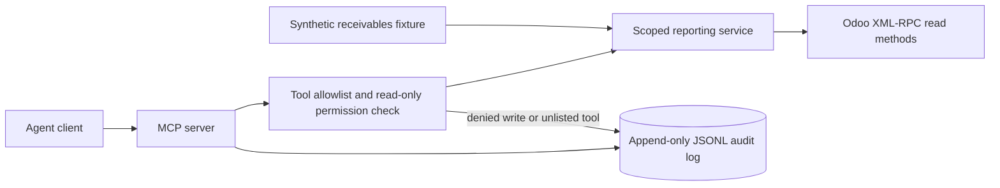

# OmniERP Agent Bridge

Read-only, permission-scoped MCP tools for Odoo reporting, with a JSONL audit record for every tool invocation.

[](https://github.com/gharisj3/omnierp-agent-bridge/actions/workflows/ci.yml)

## Why this exists

ERP users often need a short answer from invoices or purchase orders without navigating several screens. This MCP server exposes a fixed set of named reporting tools and records each accepted, failed, or denied action. The repository contains no client ERP data or credentials.

This is a public reimplementation of patterns I've used in production client work. Client code and data are not included.

## Architecture



- `server.py` exposes fixed MCP tools; there is no arbitrary model/domain endpoint.
- `PurchaseService` and `ReceivablesService` build fixed Odoo queries with bounded result limits.
- `audit.py` checks each tool against the allowlist and appends outcomes to the configured audit file.
- `OdooClient` permits only XML-RPC `read` and `search_read` methods.

## Guardrails and security model

The agent can call only names in `ALLOWED_TOOLS`. Deterministic Python validates tool inputs, caps result counts, constructs the allowed model/domain/field combinations, and rejects every write attempt before any Odoo call. The Odoo client has a second method-level check that allows only `read` and `search_read`. Each tool result, error, or denial is appended to `AUDIT_LOG_PATH` with its name, arguments, outcome, and timestamp. The log can contain business query arguments; protect and retain it accordingly. Use a dedicated Odoo account with read-only ACLs as a second boundary.

## Quickstart

Requires Python 3.11 or newer.

```sh
python -m venv .venv
# Linux/macOS: . .venv/bin/activate
# Windows PowerShell: .\.venv\Scripts\Activate.ps1
make setup
make test
make demo
```

The local demo uses synthetic fixtures and needs no Odoo account. To connect the MCP server to an Odoo instance, copy `.env.example` to `.env`, replace the placeholder Odoo settings, use a read-only account, and run:

```sh
python -m omnierp_agent_bridge.server
```

The package can also be installed with `pip install -e ".[dev]"`. Set `ALLOWED_TOOLS` to a comma-separated allowlist and `AUDIT_LOG_PATH` to a protected writable path.

## Demo

`make demo` runs the same fixed overdue-receivables service against two synthetic invoices, writes a successful tool audit row, then attempts an invoice write and records a denial.

```text
Fixture mode: no Odoo instance or model API is called.
Agent request: "show overdue receivables"
Scoped tool: get_overdue_receivables
Denied write: write operations are disabled
Audit rows:
{"outcome":"success","tool":"get_overdue_receivables", ...}
{"outcome":"denied","tool":"create_invoice", ...}
```

## Evaluation and testing

Run `make test` for pytest. The tests cover query scoping, input limits, malformed configuration, successful audit writes, and a denied write that never executes. The local suite passes 13 tests. `ruff check .` and `ruff format --check .` pass. A full-history secret scan and clean-clone Makefile run remain pending.

## Design decisions and trade-offs

- Fixed business tools are easier to review than exposing arbitrary Odoo model access.
- Read-only XML-RPC methods are enforced in code and should also be restricted by Odoo ACLs.
- JSONL audit records are simple to inspect locally; production deployment should ship them to access-controlled durable storage.
- The MCP server does not call an LLM. A separate agent client chooses when to call a tool; the offline demo exercises the tool boundary without pretending to be a model response.

## Production notes

A real deployment should add transport authentication, tenant/company scoping, audit integrity controls, log rotation, rate limits, connection pooling, and alerting. Verify Odoo record rules and field-level permissions for the dedicated service account.

## Author

Muhammad Gharis Javed — AI Engineer / AI Architect · github.com/gharisj3 · linkedin.com/in/muhammadgharis-javed

